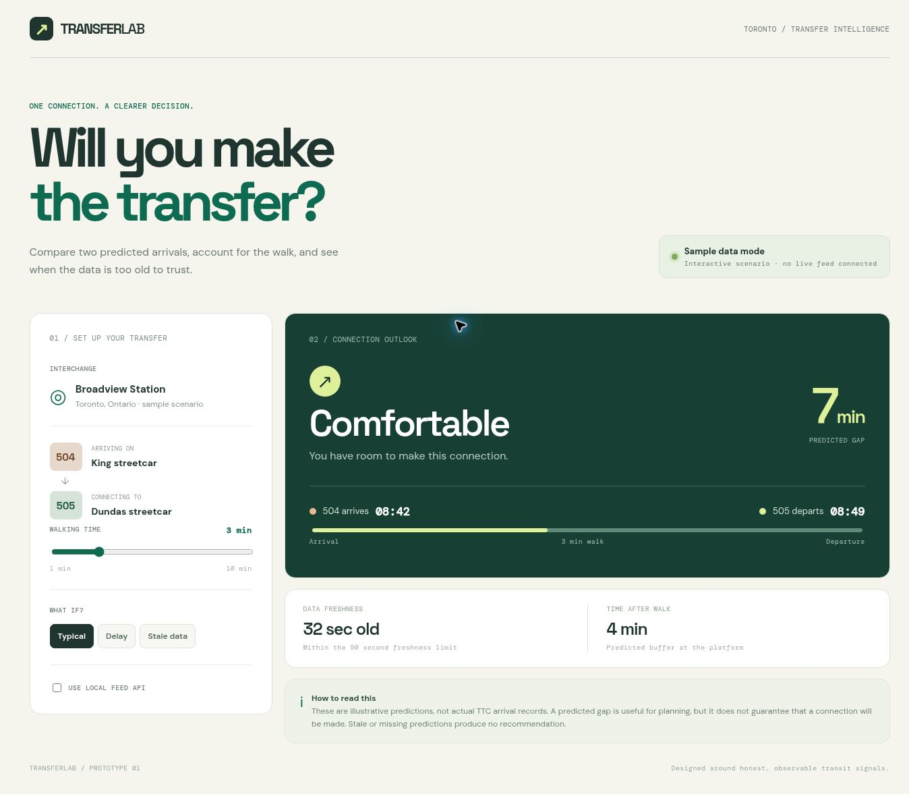
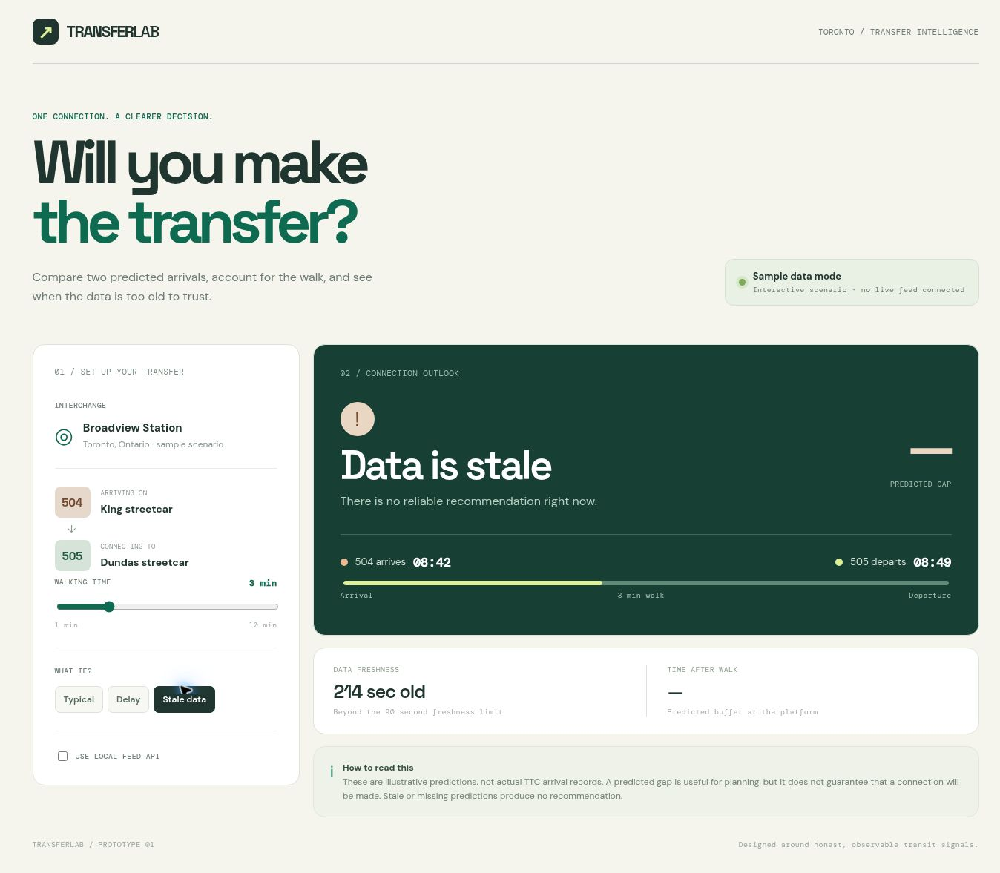

# TransferLab

**A transfer forecast explorer that says when its data is too old to trust.**



> The included sample scenario uses illustrative predictions. It is not
> connected to a live TTC feed and does not claim actual transfer success rates.

## What it does

Choose a walking time and compare the predicted arrivals for two connecting
routes. The app classifies a predicted connection as comfortable, tight, or
missed. Candidate predictions older than 90 seconds produce a stale-data state instead
of a recommendation. The local interface includes typical, delayed, and stale
sample scenarios.

For a configured GTFS-Realtime TripUpdates feed, the local ingester stores
prediction snapshots in SQLite. The local API then reads the latest predictions
for a stop and route pair.

## Screenshots

The screenshots show the included sample scenarios, with the sample-data label visible.
The opening image shows a typical connection. Here, old predictions prevent a
recommendation:



## Run locally

For the sample interface, no package install is needed:

```bash
python3 server.py --port 8000
```

Open `http://127.0.0.1:8000`.

To connect a permitted GTFS-Realtime **TripUpdates** feed:

```bash
python3 -m venv .venv
source .venv/bin/activate
pip install -r requirements.txt
GTFS_RT_TRIP_UPDATES_URL='https://YOUR-FEED-URL' python ingest.py --db transferlab.db
```

In a second terminal, from the same directory:

```bash
TRANSFERLAB_DB=transferlab.db python server.py --port 8000
```

In the UI, enable **Use local feed API** and enter the GTFS stop ID and two
route IDs from that feed. The sample station name and route badges are part of
the demo UI; the local API query uses the IDs you enter. If your provider
requires credentials or custom headers, adapt `ingest.py` to its published
access rules. The project does not embed an undocumented TTC endpoint.

## Test

```bash
python3 -m unittest discover -v
```

The tests cover walking thresholds, stale and missing predictions, next arrival
selection, and historical forecast calculations. GitHub Actions runs them on
Python 3.11 and 3.12.

## How it works

`ingest.py` parses GTFS-Realtime TripUpdates into a SQLite `predictions` table.
`server.py` exposes `/api/transfer?stop=...&from=...&to=...&walk=...`.
`analysis.py` applies the walking-time and freshness rules. `dist/` contains
the static interface and its self-contained sample scenarios.

**Tradeoff:** trip updates predict arrivals; they are not proof that a vehicle
actually stopped. The current app reports a *predicted gap*, not a calibrated
probability of making the transfer. A future version could correlate vehicle
passage, scheduled service, and outcomes over time before reporting reliability.
